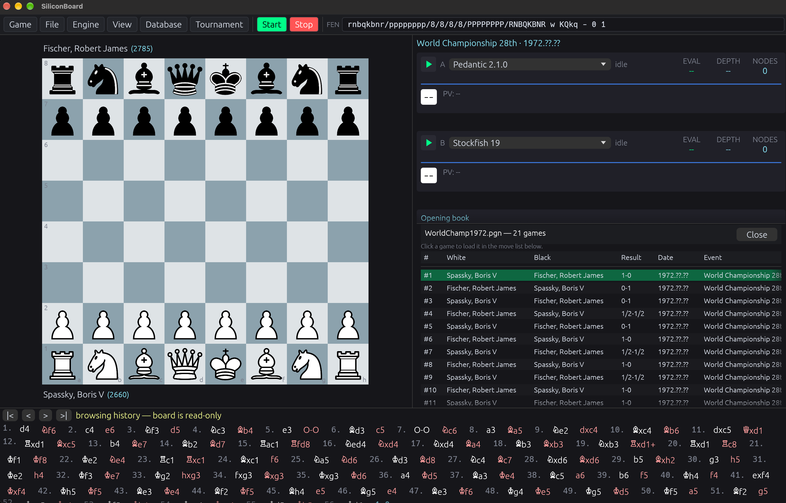

# SiliconBoard



A native **UCI chess GUI written in Rust** with `egui`/`eframe` and `wgpu`.
Board on the left, live engine analysis on the right, the move list along the
bottom, and a flat toolbar across the top. It runs on **macOS (Apple Silicon)**,
**Linux (x86-64)** and **Windows (x86-64)** from the same source tree.

- **Analysis:** two engine slots with live depth, nodes, speed, evaluation
  and principal variation; a best-move arrow on the board for each engine
  (green for A, red for B); Start / Abort; per-card play/pause. Each card's
  engine name is a pulldown of the known engines (loaded A/B and the engines
  used before, remembered across launches, the same list as the tournament
  window) with Browse….
- **Play:** human vs engine (either colour), engine vs engine, clocks with
  flag handling, resign, draw offers, threefold-repetition claims.
- **Play from a position:** paste a FEN into the top bar and choose
  _Game → Start from here…_ — two engines play on from that position with the
  current time control, and the saved PGN starts there (`SetUp`/`FEN`).
- **Set up a position:** _Game → Setup board…_ opens an editor with a piece
  palette, side-to-move and castling controls, a FEN field and a validity
  check. Close applies the position; Cancel leaves the game unchanged.
- **Engine care:** a watchdog restarts or stops an unresponsive engine,
  launcher scripts and broken files are checked before start, failed starts
  report a reason.
- **Tournaments:** **Match**, **Round-Robin** and **Gauntlet** formats play on
  the main board with time control, books, adjudication and one PGN.
- **Chess databases:** keep game collections in SQLite-backed `.sbd` files,
  import PGN or Scid collections, filter and sort them, and load a game onto
  the board. See [Chess databases](#chess-databases).
- **Everything else:** PolyGlot opening books, PGN open/save including a
  multi-game browser, FEN import/export, board themes and piece sets,
  figurine piece letters, persistent settings, a session log.

A short feature summary is in [features-list.md](features-list.md); what
changed in the current version is in [RELEASE_NOTES.md](RELEASE_NOTES.md).

## Download

Ready-to-run builds are published on the
[Releases](https://github.com/JoergKau/SiliconBoard-ChessGUI/releases) page.
Each release carries one asset per platform — the source is the same, but the
packaged form differs:

| Platform | Asset | Start it with |
| --- | --- | --- |
| macOS (Apple Silicon) | `SiliconBoard-<version>-macos-arm64.zip` | unpack, drag `SiliconBoard.app` to `/Applications`, double-click |
| Linux (x86-64) | `SiliconBoard-<version>-linux-x86_64.tar.gz` | `tar xzf …`, then `SiliconBoard-<version>-linux-x86_64/bin/siliconboard` |
| Windows (x86-64) | `SiliconBoard-<version>-windows-x86_64.zip` | unpack, then run `bin\siliconboard.exe` |

Every source release also has GitHub's generated `.tar.gz`/`.zip` archives.
The macOS and Linux archives are also committed at the repository root, so a
clone is ready to run on those platforms; the Windows zip is built with
`package-windows.ps1` (see [Packaging a release](#packaging-a-release)).
Checksums for the committed archives are in [SHA256SUMS](SHA256SUMS).

**macOS first launch:** the app is ad-hoc signed but not notarized, so a
downloaded copy is quarantined. Right-click the app → **Open**, then confirm
**Open** once. Each release prints the archive's SHA-256; check a download
with `shasum -a 256 <file>` (macOS), `sha256sum <file>` (Linux) or
`Get-FileHash <file> -Algorithm SHA256` (Windows PowerShell).

**Linux:** `package-linux.sh` installs the app under `~/.local` by default
(binary, assets, icon and a `.desktop` entry); the tarball is for machines
where you only unpack and run. No engine is bundled — see the next section.

**Windows:** unpack the zip anywhere and run `bin\siliconboard.exe`. The
release is a GUI program without a console window; `package-windows.ps1`
assembles the same layout and can install it under
`%LOCALAPPDATA%\Programs\SiliconBoard` with a Start Menu entry. No engine is
bundled.

## Requirements

- macOS 12 or later on Apple Silicon, **or** a Linux x86-64 desktop with a
  working Vulkan or OpenGL driver, **or** Windows 10/11 on x86-64 with
  Direct3D 12 (the Microsoft Basic Render Driver is used when no GPU driver
  is available)
- Rust 2021 edition (`cargo`) to build from source
- At least one **UCI engine** of your choice — SiliconBoard ships none

On Windows, SiliconBoard uses the Direct3D 12 backend by default. If you want
to try another wgpu backend, set `WGPU_BACKEND` for one run, for example
`$env:WGPU_BACKEND="vulkan"` in PowerShell or `set WGPU_BACKEND=vulkan` in
`cmd.exe`.

## Loading a UCI engine (example: Stockfish)

No engine is distributed with SiliconBoard: _Engine → Load engine A…_ and
_Load engine B…_ always open the native file picker, and whichever engine
the user points them at fills the slot (loading into an occupied slot
replaces it). The chosen file is checked before it starts — on macOS and
Linux a launcher script must name an existing interpreter — and a non-program
or a binary for another operating system is refused with the reason. Each
engine keeps its own option values, which are sent again after a restart and
restored at the next launch.

Installing the free Stockfish:

1. Download from <https://stockfishchess.org/download/>.
   - **macOS:** take the macOS build; the UCI binary inside is
     `stockfish-macos-universal`.
   - **Linux:** take the Linux x86-64 build (or install your distribution's
     `stockfish` package, usually `/usr/games/stockfish`).
   - **Windows:** take the Windows x86-64 build; the UCI binary inside is
     `stockfish-windows-x86-64-*.exe`.
2. Unpack the file if needed.
3. In the GUI, _Engine → Load engine A…_ and point it at that binary.

On Windows the file picker also accepts `.bat`, `.cmd` and `.ps1` launchers,
so a small wrapper script that starts an engine works as it does on the other
platforms.

The process is the same for any other UCI engine: unpack it and point the
menu at its executable.

## Building and running

```shell
cargo run --release
```

On Windows, install the Rust MSVC toolchain and the Visual Studio C++ build
tools (the bundled SQLite and the MSVC linker need them), then run the same
command from PowerShell or `cmd.exe`. A debug build keeps the console open for
the session log; a release build is a windowed application without a console.

The **asset tree** is bundled in this repository under `public/`: board
themes under `public/images/board/`, piece sets (twelve SVGs per folder)
under `public/piece/`, the figurine font at `public/font/lichess-chess.ttf`
and the CC0 ECO openings table at `public/data/openings/openings.tsv` — a
fresh clone runs fully dressed. The per-asset licences (lichess and its
piece authors, typically CC-BY-SA) are documented in
[`public/LICENSING.md`](public/LICENSING.md). SiliconBoard finds the tree via
`$SILICONBOARD_PUBLIC_ROOT`, by walking up from the executable, or as
`./public` (the bundled copy is normally found by the walk-up);
`$SILICONBOARD_PUBLIC_ROOT` points a development setup at a different tree.
The workspace copy is refreshed from the canonical shared tree with
`./sync-public.sh`. The window icon is compiled in from `assets/icon/`
(`siliconboard-512.png`).

SiliconBoard does **not** ship an opening book and loads none by default:
the app starts bookless. Load one via _Engine → Load PolyGlot book…_ —
the choice is kept in the settings and restored at the next start-up.
`$SILICONBOARD_BOOK` names an explicit start-up book instead. For a book
to download, we recommend the
[PolyGlot book collection](https://github.com/ChrisWhittington/polyglot-books).

## Syzygy tablebases

Engines can use Syzygy tablebase files (`*.rtbw` / `*.rtbz`) for endgame
knowledge — perfect play once few pieces are on the board. Point the GUI at
your installation once via _Engine → Load tablebases…_: enter the tablebase
folder(s) in the dialog (or pick them with **Browse…**, which accepts
several folders) and press Apply. The path is kept in the settings and sent
to every loaded engine — and to every engine loaded later — as the
`SyzygyPath` option.

- Several folders are joined into **one string**, separated by `:` on macOS
  and Linux and `;` on Windows. This matters when the 5-men and 6-men files
  live in different folders, as in
  `/home/you/EGTB/Syzygy-3-4-5:/home/you/EGTB/Syzygy-6`.
- Applying an empty line clears the tablebases again: the loaded engines get
  an empty path, and engines started afterwards get none.
- The GUI forwards the string untouched — which folder holds which files,
  and whether an engine supports tablebases at all, is the engine's
  business; a user choosing paths knows what they are doing. Look in the
  session log for the engine's own report, e.g.
  `Found 510 WDL and 510 DTZ tablebase files (up to 6-man)`. The files and
  what to download are described at
  [syzygy-tables.info](https://syzygy-tables.info/).

## Chess databases

SiliconBoard keeps chess databases as one SQLite file each (`*.sbd`). Games
are stored exactly as the PGN they came from, so comments, variations, NAGs
and unknown tags survive; a metadata index beside them makes filtering and
sorting instant even for millions of games.

- **New database…** (Database menu) asks for a name, a description and a PGN
  file, then imports it. The result lives in
  `~/Documents/SiliconBoard/databases/<file name>.sbd`.
- **Open database…** opens an `.sbd`; a `.pgn`, `.si4` or `.si5` is offered
  as a new database instead, so a downloaded collection or a Scid file is
  converted once and opens instantly afterwards.
- The overview shows the game, player and event counts and the housekeeping
  actions: **Remove Duplicates** (same players, date, result and move count),
  **Remove Empty Games**, **Add Games** (import another PGN) and
  **Export to PGN**.
- **Open database →** shows the browser: filter by player name, side, Elo,
  event, result, year and position; click a column header to sort; double
  click a game to load it on the board.
- Re-importing the same file adds nothing — every game carries a stable
  fingerprint — so the monthly update of a downloaded collection only
  appends what is new.

The **Position** filter matches a FEN against an index of every position of
each game. That index is built during an import when *Index
positions* is ticked (it is on by default and makes the import slower); a
database imported without it says so when the Position field is used.

Scid support (`si4`/`si5`) comes from a GPL-3.0-or-later crate and is a
Cargo feature (`scid`, on by default). Converting a Gigabase takes a while
and needs roughly the size of the three Scid files in memory while it runs.
Nothing is downloaded: the Lumbras Gigabase and similar collections are
CC BY-NC 4.0 and must be fetched by the user.

## Settings, logs and files

Paths follow the platform's conventions:

| What | macOS | Linux | Windows |
| --- | --- | --- | --- |
| Settings | `~/Library/Application Support/SiliconBoard/settings.json` | `~/.config/siliconboard/settings.json` (`$XDG_CONFIG_HOME`) | `%APPDATA%\SiliconBoard\settings.json` |
| Session logs | `~/Library/Logs/SiliconBoard/` | `~/.local/state/siliconboard/logs/` (`$XDG_STATE_HOME`) | `%LOCALAPPDATA%\SiliconBoard\logs\` |
| Databases | `~/Documents/SiliconBoard/databases/` | `~/Documents/SiliconBoard/databases/` | `%USERPROFILE%\Documents\SiliconBoard\databases\` |
| Tournament PGN | `~/Documents/SiliconBoard/engine-match.pgn` | `~/Documents/SiliconBoard/engine-match.pgn` | `%USERPROFILE%\Documents\SiliconBoard\engine-match.pgn` |

On Windows the Documents folder is read from the system, so a redirected or
OneDrive-synced Documents folder is used instead of assuming
`%USERPROFILE%\Documents`.

The session log records start-up and settings messages, engine life-cycle
events, the UCI commands and replies exchanged with each engine, engine
stderr, and errors. _Engine → Session log_ switches file logging at runtime;
it is on by default and the choice is kept in the settings. The newest five
logs are kept, and a log that reaches 5 MB is continued in `-2.log`,
`-3.log`, …, so the folder stays at about 25 MB.

Two environment variables change logging for one run:

- `SILICONBOARD_LOG=trace` also records every engine line and the
  `isready` / `readyok` heartbeat. The default file filter is
  `info,siliconboard::engine=debug,siliconboard::app=debug`.
- `SILICONBOARD_LOG_FILE=/path/to/file.log` writes one named file instead of
  the per-run log. That file is truncated at start-up and is not rotated or
  pruned.

`SILICONBOARD_SETTINGS=/path/to/settings.json` uses another settings file.
`SILICONBOARD_PUBLIC_ROOT` and `SILICONBOARD_BOOK` are described above.

## Packaging a release

The macOS, Linux and Windows scripts read the version from `Cargo.toml` and
print the archive's SHA-256. The generated archives are committed at the
repository root and attached to a GitHub release.

**macOS:**

```shell
./package-macos.sh            # build, sign, zip and install into /Applications
./package-macos.sh --no-install   # build and zip only
```

The script runs `cargo build --release`, then assembles `SiliconBoard.app`:
the binary as `Contents/MacOS/SiliconBoard`, the icon and the asset tree as
`Contents/Resources/public` — the layout the asset resolver checks first in
a bundle (unit-tested in `src/assets.rs`) — and writes `Contents/Info.plist`
with the version taken from `Cargo.toml`, the bundle identifier
`org.chess-gui.SiliconBoard` and the About-panel copyright
(`macos_about.rs` reads both from the bundle). `plutil -lint` guards the
plist, and the bundle is signed ad-hoc:

```shell
codesign --force --deep --sign - SiliconBoard.app   # the script does this
```

The distributable zip holds one folder with the signed app plus
`LICENSE`, `LICENSE-MIT`, `THIRD-PARTY-NOTICES.md`, `README.md`,
`RELEASE_NOTES.md` and `features-list.md`. The app is signed _before_ it is
zipped (modifying a signed app breaks the seal), and the zip is verified by
unzipping it and re-checking the signature. The bundle also carries the
start-up PGN (`Contents/Resources/PGN/WorldChamp1972.pgn`), so launch opens
Spassky–Fischer, game 1, and the multi-game list is ready.

Installing is the default: the script replaces an existing copy in
`/Applications`, removes the dev-folder bundle and unregisters it with
Launch Services, so Launchpad shows exactly one icon. `--no-install` (or
`-n`) skips that step and leaves the bundle in the repo folder. If
`/Applications` cannot be written, the script asks once for administrator
rights.

**Linux:**

```shell
./package-linux.sh            # build, package and install under ~/.local
./package-linux.sh --no-install   # build and package only
```

The script assembles `SiliconBoard-<version>-linux-<arch>/` with the binary
in `bin/`, the assets in `public/`, the start-up PGN in `PGN/`, a `.desktop`
launcher, the icon and the licence texts, then builds the `.tar.gz` and
verifies it by unpacking. The install step puts the binary, assets and icon
under `~/.local/share/siliconboard` and a launcher in `~/.local/bin`.

**Windows:**

```powershell
.\package-windows.ps1              # build and zip
.\package-windows.ps1 -Install     # also copy to %LOCALAPPDATA%\Programs and add a Start Menu entry
```

If PowerShell refuses to run a local script, start it through the host:
`powershell -ExecutionPolicy Bypass -File .\package-windows.ps1`.

The script runs `cargo build --release` and assembles
`SiliconBoard-<version>-windows-x86_64\` with the executable in `bin\`, the
assets in `public\`, the start-up PGN in `PGN\` and the licence texts, then
writes the `.zip` and prints its SHA-256. The folder can be moved anywhere:
the asset resolver walks up from `bin\siliconboard.exe` to the neighbouring
`public\` and `PGN\`.

**Publishing:** create one release tag (for example `v1.4.1`) and attach one
asset per platform plus a `SHA256SUMS` file. The macOS `.app` bundle, the
Linux tarball and the Windows zip are different on purpose and cannot share
one artifact. Keep the committed copies at the repository root in step with
the release assets.

## Development

```shell
cargo test --bin siliconboard     # unit + real-engine integration tests
cargo clippy --all-targets        # zero warnings
```

The real-engine tests need an available UCI engine fixture
(`$SILICONBOARD_TEST_ENGINE`, or Stockfish in a usual location); they fail
(rather than skip) when it is missing. On Windows the search covers
`stockfish.exe` on `PATH` and the usual `C:\Program Files\Stockfish` install
folders. The opening-book tests use small built-in books, so no external
`.bin` file is needed. The shell-script engine fixtures run on macOS and
Linux; on Windows a PowerShell fixture exercises the same engine paths.

## AI Assisted by DeepSeek V.4.1 Flash

## Licence

**SiliconBoard's own source is MIT** — see [LICENSE-MIT](LICENSE-MIT).

The application links the chess-rules crate
[`shakmaty`](https://github.com/niklasf/shakmaty) and, unless the `scid`
feature is switched off, the Scid reader
[`chess-scid-rw`](https://github.com/Fab2bprog/chess-scid-rw), both licensed
**GPL-3.0-or-later**. A Rust binary links its crates statically, so the
**application as distributed is a combined work under GPL-3.0-or-later**.
The full licence text is in [LICENSE](LICENSE);
[THIRD-PARTY-NOTICES.md](THIRD-PARTY-NOTICES.md) lists every crate in the
build with its licence.

Practically:

- the original SiliconBoard files may be used under MIT **or** under
  GPL-3.0-or-later;
- the combined application — the thing you install and run — is
  GPL-3.0-or-later, including the right to obtain its complete source;
- the corresponding source for a release is this repository at that
  release's tag (the release notes name the tag).

**Credits:** the bundled board themes, piece sets and the figurine font are
**lichess artwork** (`lichess.org`, asset repository
[`lichess-org/lifat`](https://github.com/lichess-org/lifat)), by the
respective CC-BY-SA-type upstream authors (e.g. the default `cburnett`
pieces by Colin M. L. Burnett). The ECO openings table is CC0. The summary
with sources and terms per asset family is in
[`public/LICENSING.md`](public/LICENSING.md).
